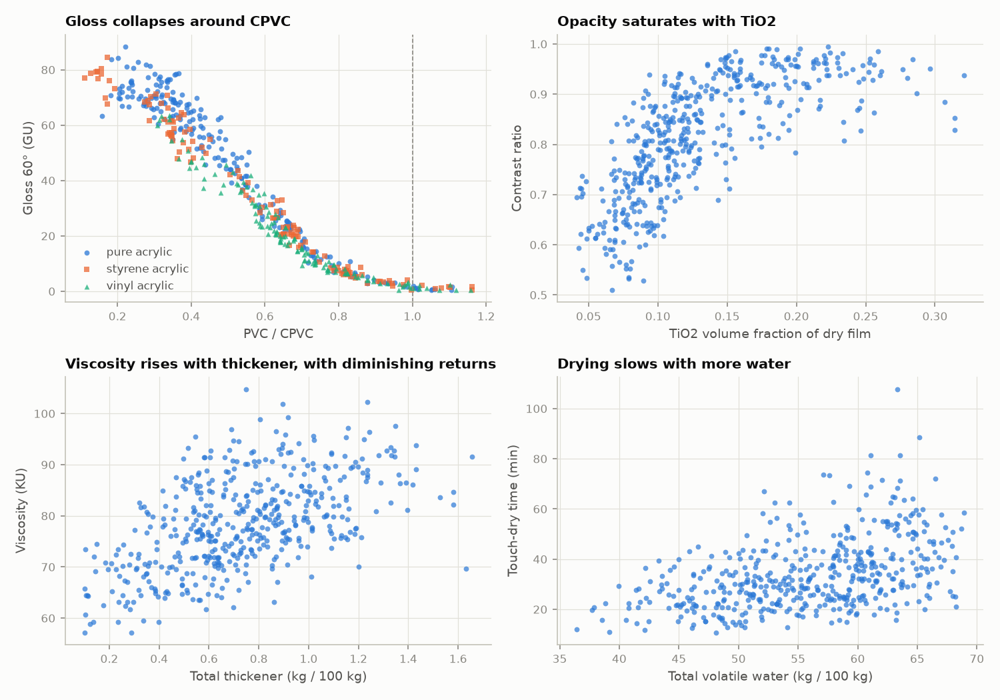
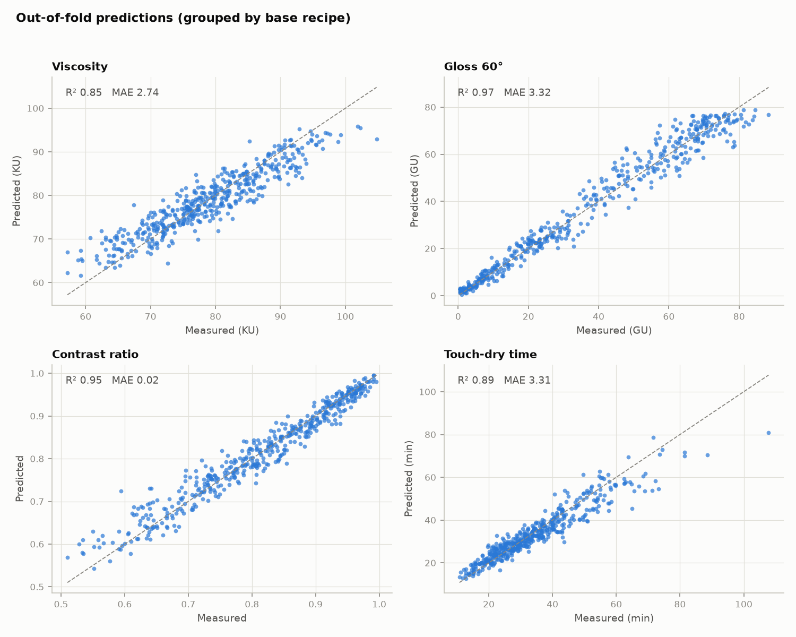
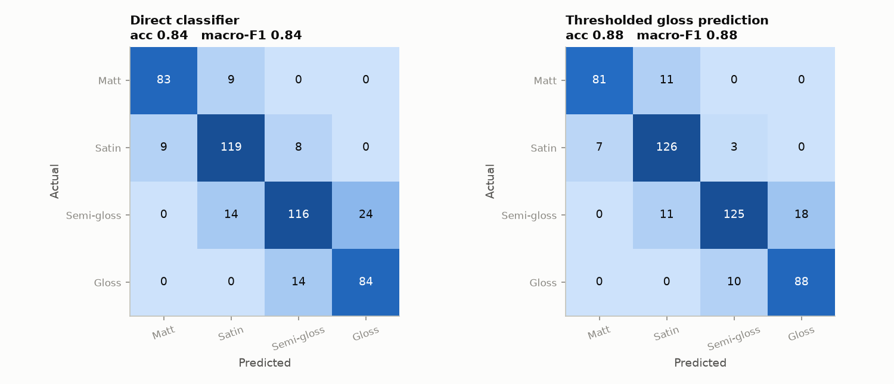
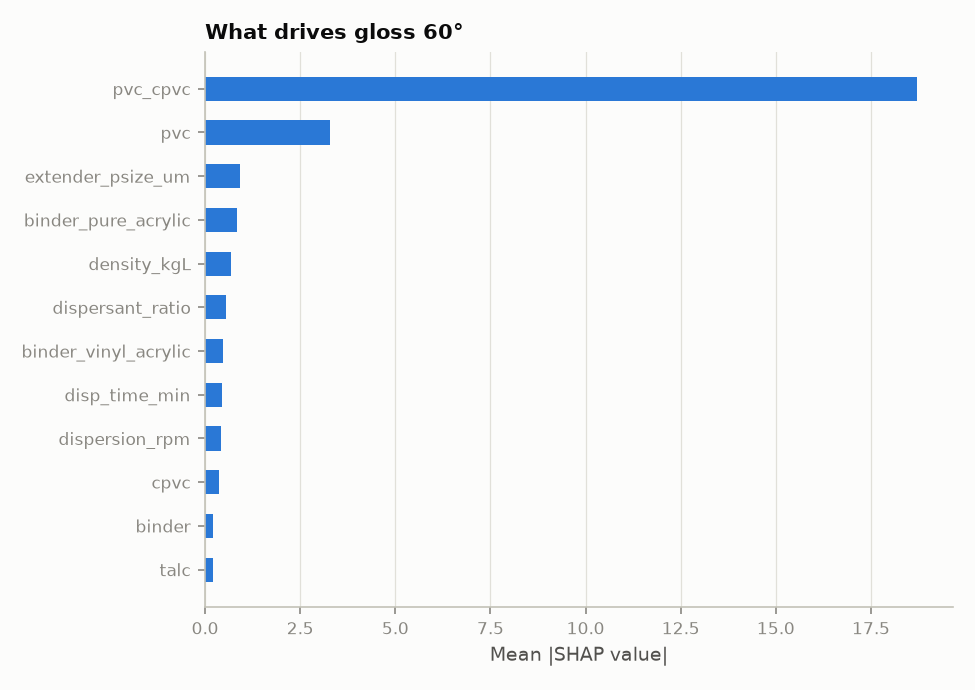

# Paint Formulation ML

Predict the properties of a water-based emulsion paint from its formulation, and work backwards from target properties to a low-cost recipe.

> **Important:** all data in this repository is **synthetic**. Properties are simulated from simplified paint-science relationships plus noise. The code, validation approach and workflow are real; the numbers are **not** measurements of real paint. Do not use the predictions for real formulation decisions.

## What it does

| Step | What happens | File |
|---|---|---|
| 1. Features | Converts a recipe (kg per 100 kg) into paint-science features: PVC, CPVC, PVC/CPVC, volume solids, VOC, cost | `paint_science.py` |
| 2. Data | Generates 480 synthetic batches (80 base recipes x 6 lab-style variants) | `generate_data.py` |
| 3. Models | Trains Ridge, Random Forest and LightGBM for each property, validated with grouped cross-validation | `train.py` |
| 4. Predict | Streamlit page: enter a recipe, get predictions with 90% ranges | `app.py` |
| 5. Suggest | Streamlit page: enter target properties, get the cheapest qualifying recipes | `design.py`, `pages/1_Suggest_recipe.py` |

**Predicted properties:** viscosity (KU), gloss at 60 degrees, contrast ratio (opacity), touch-dry time, and finish class (Matt / Satin / Semi-gloss / Gloss).

## Quick start

```bash
pip install -r requirements.txt
python generate_data.py      # optional: the CSV is already included
python train.py              # trains models, writes models/ and reports/
streamlit run app.py         # opens the app; both pages are in the sidebar
python design.py             # command-line recipe search example
```

Re-run `train.py` whenever you change the data or the generator.

## Key ideas

- **PVC / CPVC is the main feature for gloss.** PVC is the pigment share of the dry film volume. CPVC is the point where the binder runs out. Their ratio tells the model how close the paint is to losing gloss.
- **Grouped cross-validation.** Variants of the same base recipe never appear in both training and test data. A random split would flatter the model, so the script reports both.
- **Uncertainty.** Each prediction comes with a 90% range taken from out-of-fold errors.
- **Physics rules.** Monotonic constraints, for example more thickener cannot lower viscosity.
- **Finish from gloss.** The finish class is derived from predicted gloss, which scored better than a separate classifier.

## Results (synthetic data, grouped 5-fold CV)

| Property | Best model | R2 | MAE | 90% range |
|---|---|---|---|---|
| Gloss 60 deg | LightGBM | 0.969 | 3.3 GU | +/- 8.0 GU |
| Contrast ratio | LightGBM | 0.949 | 0.019 | +/- 0.044 |
| Touch-dry time | Ridge (log target) | 0.952 | 2.2 min | about +/- 23 % |
| Viscosity | LightGBM | 0.848 | 2.7 KU | +/- 6.0 KU |

**Finish class** (from predicted gloss): accuracy 0.875, macro-F1 0.877.

Notes:
- LightGBM won three of four properties. Ridge won touch-dry time (LightGBM: R2 0.893) because that property was simulated as a product of terms, which is linear in logs.
- The gap between grouped and random-split scores is small on this data (for example gloss 0.969 vs 0.977). With real lab data it is likely to be larger.
- The gloss class was initially almost empty. The generator now includes a binder-rich "glossy" group (30% of base recipes), which raised finish macro-F1 from 0.68 to 0.88.

### Charts









## Recipe suggestion

`design.py` and the "Suggest a recipe" page use a random search:

1. Draw 30,000 candidate recipes from the ranges the models were trained on.
2. Predict all properties for every candidate.
3. Keep candidates that meet every target. A **safety margin** (0 to 1) moves each prediction against you by that fraction of its 90% range before the check.
4. Rank the survivors by ingredient cost.

The page also shows which requirement limited the search. For example, high gloss and high opacity together are very rare, because high gloss needs low pigment while high opacity needs a lot of TiO2.

## Limitations

- **Synthetic data.** The models learned the formulas written into `generate_data.py`, not real paint behaviour. The gloss-versus-PVC/CPVC curve is smoother than in real paint.
- **Edges are less reliable.** Predictions are pulled toward the middle at extreme values. The app warns when an input is outside the training range.
- **Fixed-width ranges.** Each 90% range has one width per property, so it is too wide for low-gloss recipes.
- **Model exploitation.** A search that optimizes against a model finds recipes where the model is slightly wrong in your favour. Any suggested recipe needs a lab check.
- **Random search, not Bayesian optimization.** It is simple and transparent but not exhaustive.
- **Illustrative costs.** Prices in `paint_science.py` are placeholders.

## Roadmap

- Product type input (interior / exterior emulsion) with realistic ingredient ranges
- More raw materials: surfactant or wetting agent, pH stabilizer, HEUR thickener, film preservative
- More viscosity measures (KU, ICI, low shear) and a viscosity adjustment tool
- A defensible simulation of pH and its effect on HASE thickening
- Binder-driven targets: scrub resistance, water resistance, adhesion
- Colour module: reducing strength, tinting and shade matching
- Replace the synthetic data with real lab data

## Project layout

```
app.py                       Predict page
pages/1_Suggest_recipe.py    Recipe suggestion page
design.py                    Recipe search logic
paint_science.py             Formulas and feature engineering
generate_data.py             Synthetic data generator
train.py                     Training, validation, charts
data/paint_formulations.csv  Synthetic dataset
reports/                     Charts and metrics from train.py
requirements.txt
```
